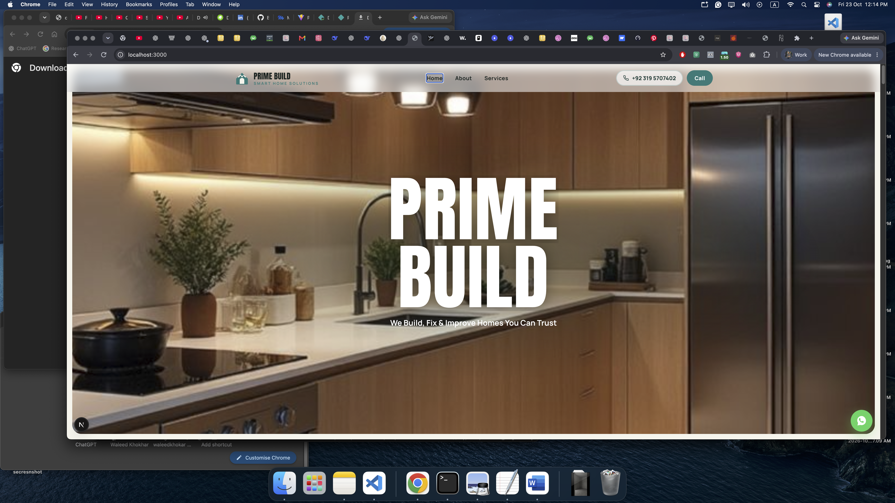
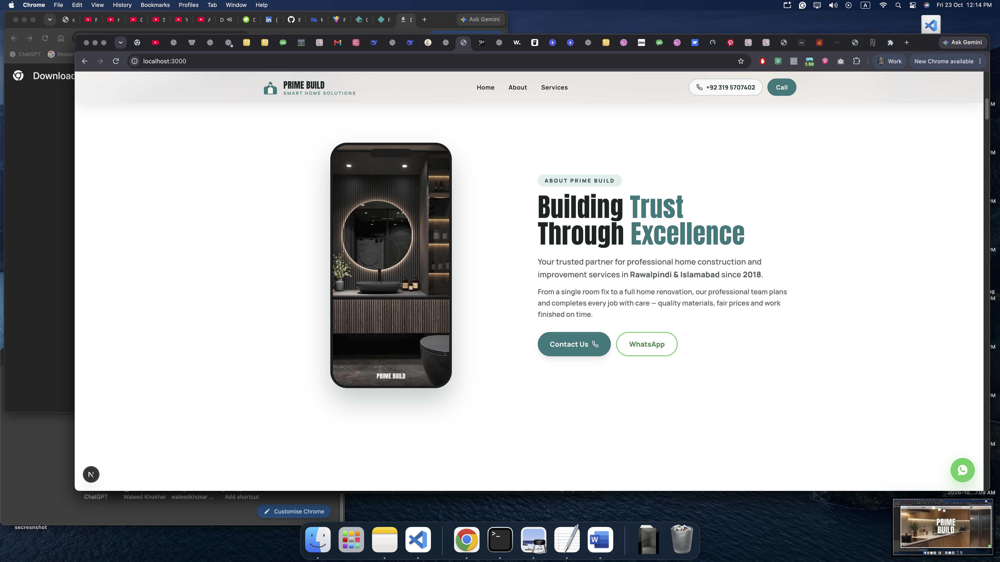
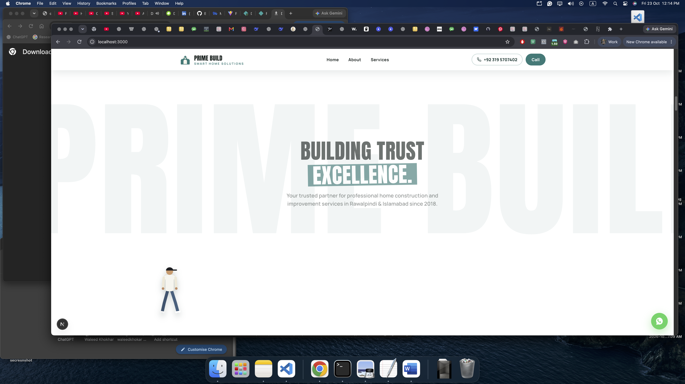
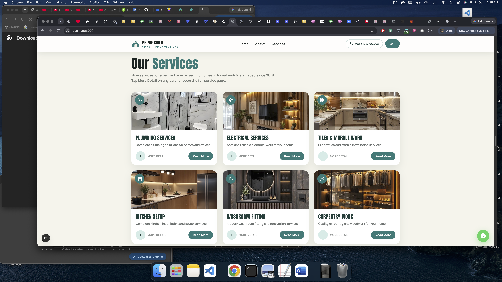
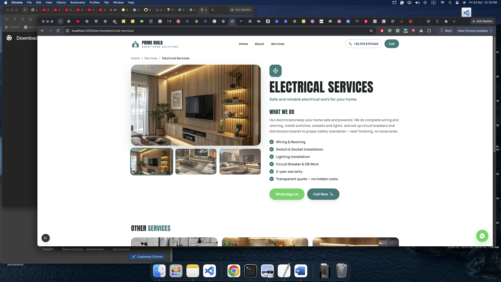
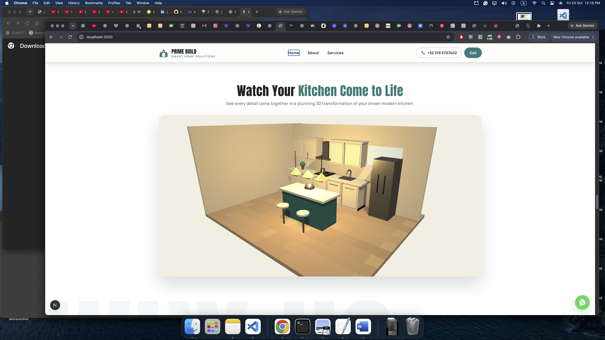
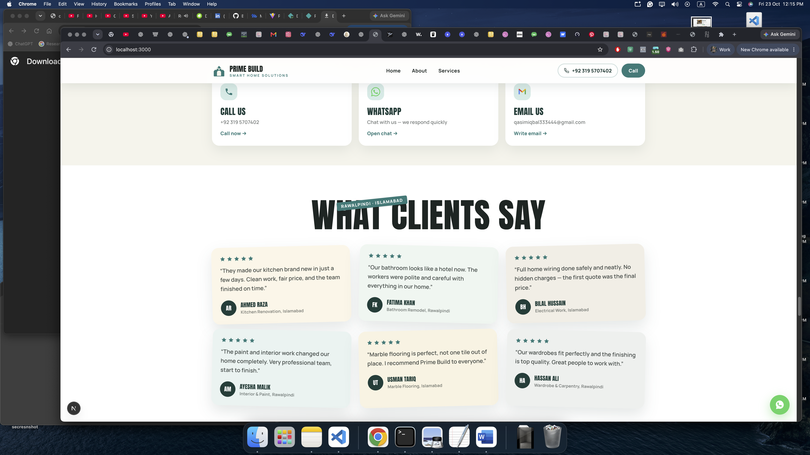
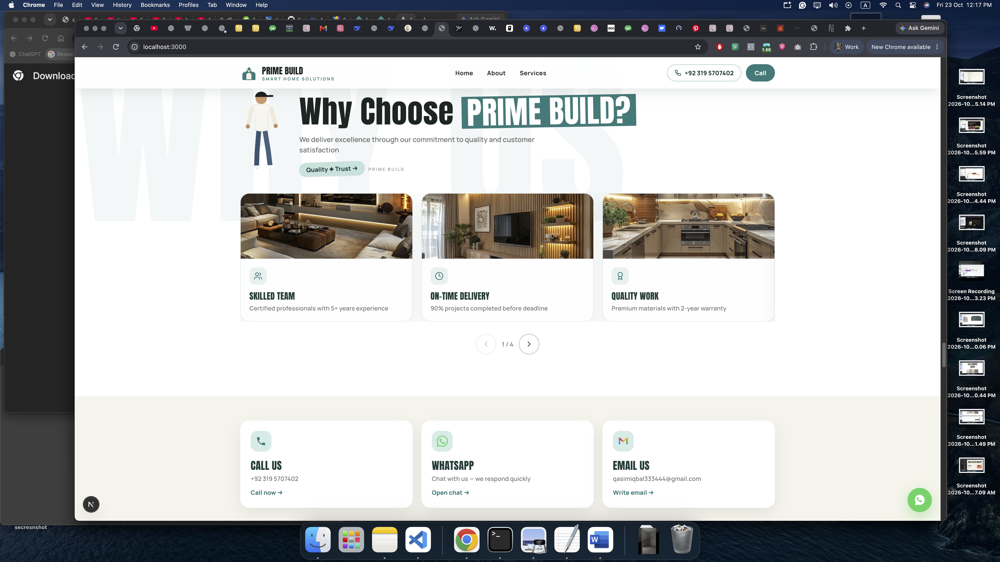
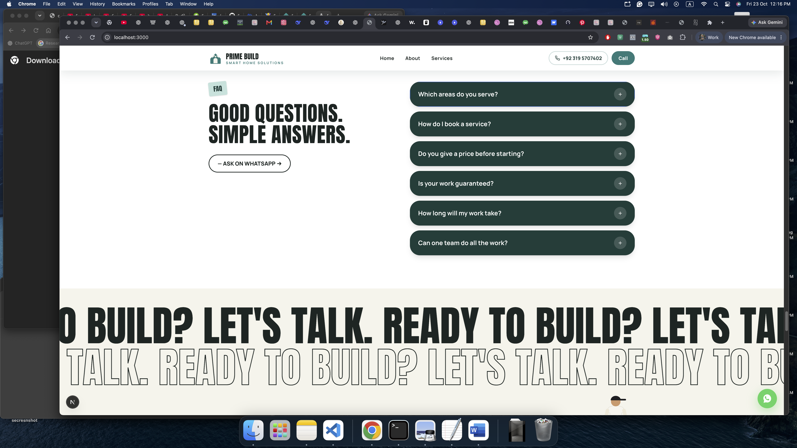

<div align="center">

# 🏠 Prime Build — Smart Home Solutions


**A modern business website for a professional home construction and improvement team in Rawalpindi & Islamabad.**

Built with **Next.js 15 · TypeScript · GSAP · Three.js**

🌐 **[Live Website](https://qasimprimebuild.vercel.app)**

</div>

----

## 🚀 About

Prime Build is a home services team working in Rawalpindi & Islamabad since **2018** — with **250+ projects**, **98% happy clients**, **50+ experts**, and **24/7 support**.

The website is made **phone-first** so homeowners can see real work and contact the team fast.

**Services:** Plumbing · Electrical · Tiles & Marble · Kitchen Setup · Washroom Fitting · Carpentry · Paint & Polish · Interior Work · Custom Solutions

---

Here is a more attractive, easier-to-read Highlights section with better visuals.

---

## ✨ What Makes This Site Special

<table>
<tr>
<td align="center" width="33%">

### 🎬
**Cinematic Hero**
Bold PRIME BUILD title reveals line by line. Scroll → panel expands full screen.

</td>
<td align="center" width="33%">

### 🚶
**Walk-Through Story**
A man walks across as you scroll. Stats, mission, vision, values — all open step by step.

</td>
<td align="center" width="33%">

### 🍳
**Live 3D Kitchen**
A real Three.js animation. Empty room builds into a finished kitchen in 15 seconds. Loops forever.

</td>
</tr>
<tr>
<td align="center" width="33%">

### 🛠️
**9 Service Pages**
Every service card opens inline. Every service has its own full page with gallery and checklist.

</td>
<td align="center" width="33%">

### ⭐
**Why Choose Slider**
12 trust cards sliding 3 at a time. Warranty, fair pricing, on-time work, local experts.

</td>
<td align="center" width="33%">

### 💬
**Reviews · FAQ · 3D Text**
Tilted review cards with star ratings. Clean FAQ list. 3D rolling text before the footer.

</td>
</tr>
</table>

---


## 📸 Screenshots

| Home  | About  | Trust  |
| :---: | :---: | :---: |
|  |  |  |

| Services  | Overview Detail | 3D Kitchen Video |
| :---: | :---: | :---: |
|  |  |  |

|  Client Reviews |Why Choose Us | FAQ Section |
| :---: | :---: | :---: |
|  |  |  |


## 🛠 Tech Stack

<div align="center">


</div>

---

## 📁 Project Structure

```text
prime-build-site/
├── public/
│   ├── projects/          # Project photos & About phone video
│   └── screenshots/       # README screenshots (1.png – 6.png)
├── src/
│   ├── app/               # Pages: /, /about, /services/[slug]
│   ├── components/        # Hero, Scroll Story, Kitchen 3D, Services, ...
│   └── lib/data.ts        # Services, reviews, FAQs & site data
├── package.json
└── README.md
```

---

## 🚀 Quick Start & Installation

Follow these simple steps to run the project locally on your system.

### Prerequisites

- **Node.js** (v18.x or higher)
- **Git**

### 1️⃣ Clone the Repository

```bash
git clone https://github.com/waleedkhokar/prime-build-smart-home-solutions.git
cd prime-build-smart-home-solutions
```

### 2️⃣ Install & Run

```bash
# Install dependencies
npm install

# Run the development server
npm run dev
```

The website will run locally at `http://localhost:3000`.

## 👨‍💻 Developer

**Waleed Khokhar**

***Full-Stack AI Engineer***

Full-Stack Developer with 1+ year of experience building scalable **web applications** and **mobile apps (Android & iOS)** with AI-powered features. Specializing in intelligent AI solutions using **Generative AI, LLMs, Agentic AI, RAG, and LangChain automation**, alongside strong proficiency in **React Native, Next.js,PYTHON & FastAPI and the MERN stack** for building modern, production-ready mobile & web apps.

## 🌐 Connect With Me

<div align="center">

[](https://waledkhokar.vercel.app/)
[](https://linkedin.com/in/waleedkhokhar)
[](https://github.com/waleedkhokhar)

</div>

---

## 📄 License

Currently a personal development and portfolio project. License terms to be defined prior to commercial deployment.

---

⭐ **If you liked this project, drop a ⭐ on the repo and share it with others!**
