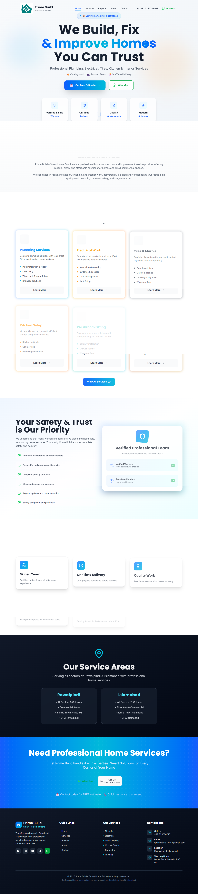
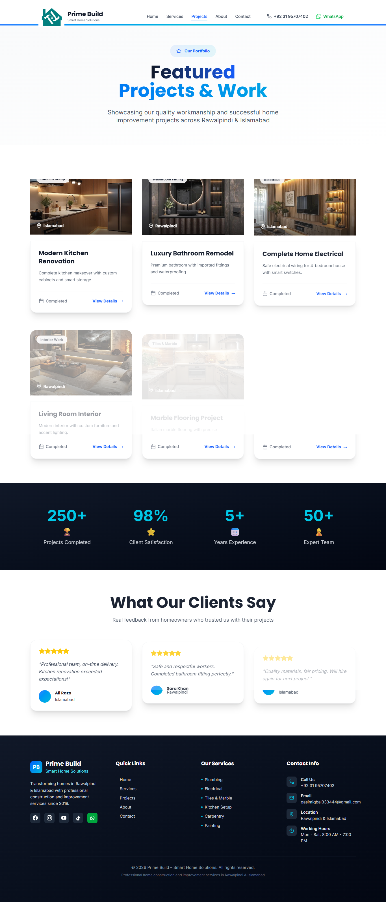
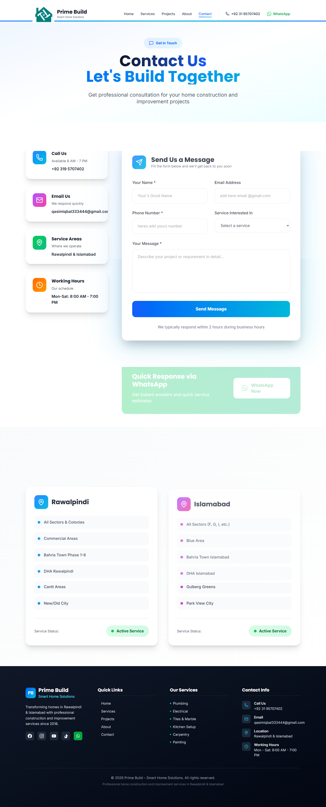

# 🏠 Prime Build – Smart Home Solutions  
**Professional Home Construction & Improvement Services Website**

> A modern, responsive business website built with React, TypeScript, Tailwind CSS & GSAP animations for a premium home services company in Rawalpindi & Islamabad.

## 🚀 Live Demo
[👉 View Live Website](https://primebuild.vercel.app) *(Replace with your actual URL)*

## 👨‍💻 Developer
**Waleed Khokhar** - Full-Stack MERN Developer & Data Analyst

[](https://waledkhokar.vercel.app)
[](https://www.linkedin.com/in/waleed-khokhar-8ba554261)
[](https://github.com/waleedkhokar)
[](mailto:waleedkhokharbusiness@gmail.com)


## 🎯 About This Project
This project demonstrates my expertise in **modern web development** as a Full-Stack MERN Developer. Built to showcase:
- ✅ Production-ready React + TypeScript development
- ✅ Professional UI/UX design with Tailwind CSS
- ✅ Interactive animations using GSAP
- ✅ SEO-friendly, mobile-responsive architecture
- ✅ Real-world business application development

## ✨ Features
- **Professional Design** - Clean, modern UI with construction theme
- **Interactive Animations** - Smooth GSAP animations on scroll & hover
- **Mobile Responsive** - Perfect on all devices
- **SEO Optimized** - Meta tags, semantic HTML, fast loading
- **Service Showcase** - 9+ home services with detailed information
- **Project Portfolio** - Real work gallery with images
- **Contact Integration** - WhatsApp, Phone, Email CTAs

## 🛠 Tech Stack
- **Frontend**: React 18, TypeScript, Tailwind CSS, GSAP, Vite
- **Icons**: Lucide React
- **Routing**: React Router
- **Deployment**: Vercel
- **Tools**: Git, ESLint, Prettier

## 📁 Project Structure
prime-build/
├── src/
│ ├── components/ # Reusable UI components (Header, Footer, ServiceCard, etc.)
│ ├── pages/ # Main pages (Home, Services, Projects, About, Contact)
│ ├── lib/ # Constants & configurations
│ ├── animations/ # GSAP animation wrappers
│ └── styles/ # Global styles
├── public/ # Static assets (images, logos)
└── package.json # Dependencies

## 🚦 Quick Start

### 1. Clone & Install
```bash
git clone https://github.com/waleedkhokar/prime-build.git
cd prime-build
npm install

## 🖼️ Project Screenshots

### Desktop View


### Services Page  


### Mobile Responsive



